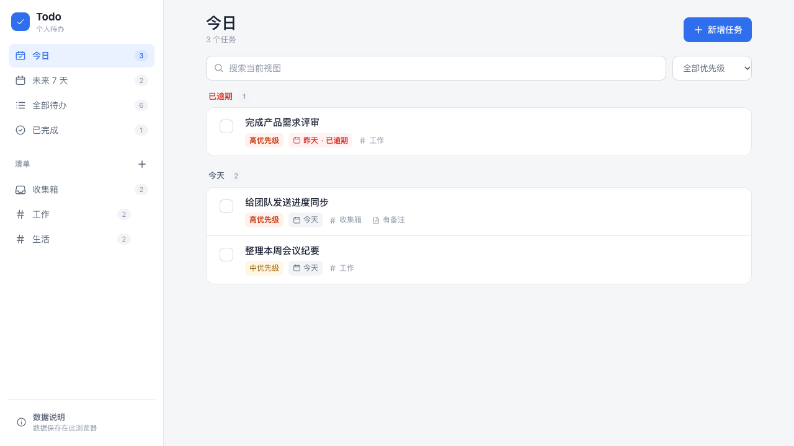
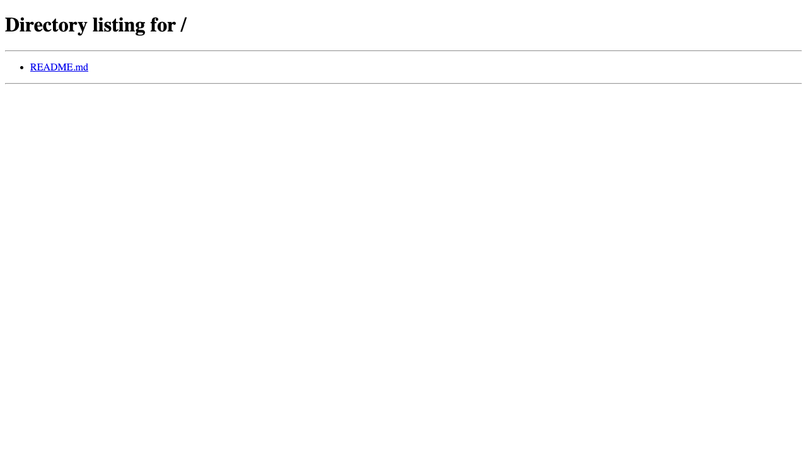
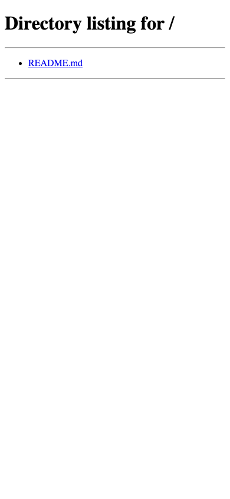
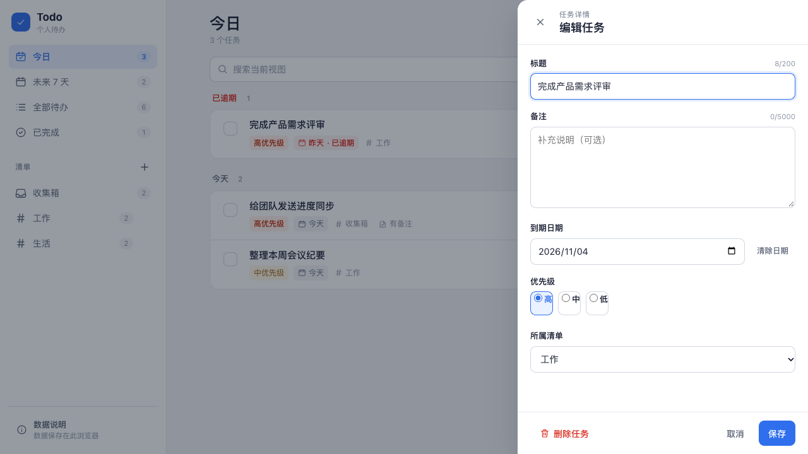
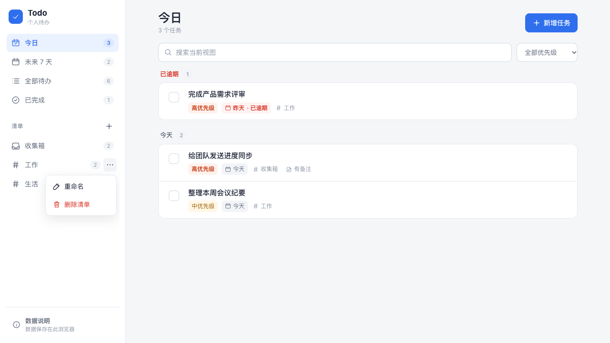
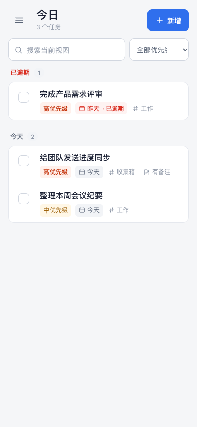
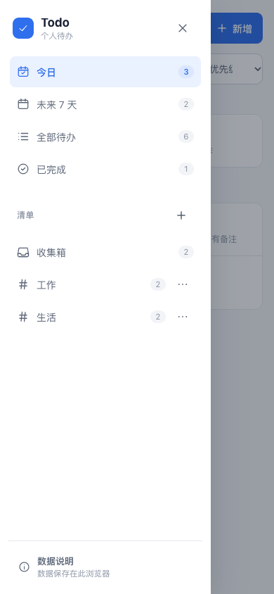
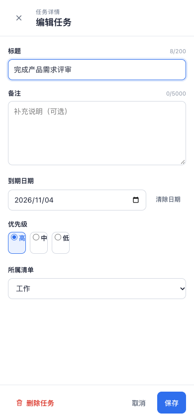
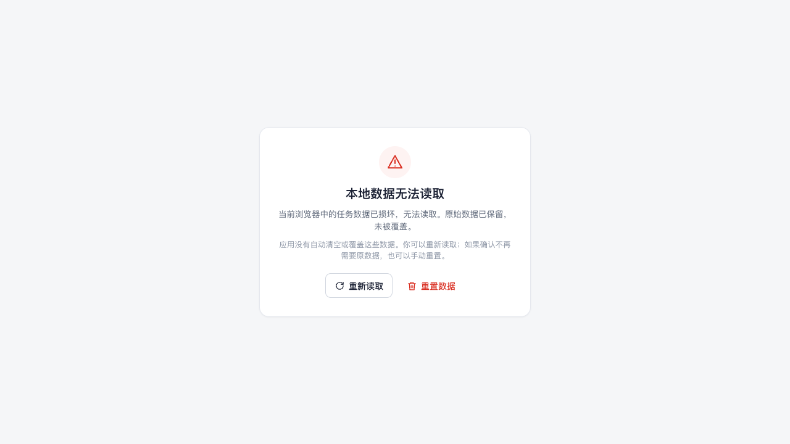

# Todo 个人待办

一个打开即可使用的响应式待办 Web 应用。无需登录，任务与清单只保存在当前浏览器。
本仓库同时作为 dsh-superagent 自动化工作流的演示仓库。



## 功能

- 任务新增、编辑、完成 / 重新打开、删除；字段包含标题、备注、到期日期、优先级和所属清单。
- 固定的「收集箱」与自定义清单：新建、重命名、删除；删除清单时，清单内全部任务会在一次写入中迁移到收集箱。
- 今日、未来 7 天、全部待办、已完成和清单视图；今日含逾期分组，未来 7 天按日期分组。
- 当前视图内的关键词搜索与优先级筛选，支持组合条件；导航数量不受筛选影响。
- 本地持久化、写入失败提示与重试、损坏数据保护、二次确认重置。
- 多标签页同步与编辑冲突检测，不会静默覆盖或恢复已删除的任务。
- 跨过本地午夜或从后台返回时自动刷新日期分组。
- 桌面侧边栏布局，手机抽屉导航与全屏任务详情；完整键盘操作、焦点回收和表单校验。

## 技术栈

React 19 + TypeScript + Vite 7。单元 / 组件测试使用 Vitest 与 Testing Library，浏览器端到端测试使用 Playwright（Chrome）。

## 本地运行

需要 Node.js 22+ 与 pnpm 10+。

```bash
pnpm install
pnpm dev          # 本地开发服务器
pnpm build        # 类型检查 + 生产构建，产物在 dist/
pnpm preview      # 预览生产构建
```

`dist/` 是纯静态站点，可部署到任意 HTTPS 静态托管；应用没有后端、账号或网络请求。发布时使用 HTTPS，以符合数据与隐私要求。

## 数据格式与保存

- 存储位置：浏览器 `localStorage`，键名 `todo-app.data.v1`。
- 当前格式版本：`1`。数据结构：

```json
{
  "formatVersion": 1,
  "lists": [
    {
      "id": "inbox",
      "name": "收集箱",
      "isSystem": true,
      "createdAt": "2026-01-01T00:00:00.000Z",
      "revision": 1
    }
  ],
  "tasks": [
    {
      "id": "task_...",
      "title": "写周报",
      "description": "",
      "status": "open",
      "priority": "medium",
      "dueDate": "2026-11-05",
      "listId": "inbox",
      "createdAt": "2026-11-05T08:00:00.000Z",
      "updatedAt": "2026-11-05T08:00:00.000Z",
      "completedAt": null,
      "revision": 1
    }
  ]
}
```

- `dueDate` 是按日历日期保存的本地日期文本（`YYYY-MM-DD`），不含时间；更换时区后日期文本不变，今日/逾期判断按新的本地日期计算。
- `status` 为 `open` 或 `completed`；已完成任务必须带 `completedAt`。
- `priority` 为 `high`、`medium` 或 `low`。
- 每条任务和清单的 `revision` 在成功修改后递增，用于多标签页编辑冲突检测。
- 每次变更都会先写入完整数据集，写入成功后才更新界面；写入失败时提示“保存失败，请重试”，并保留原始已保存数据与表单输入。
- 首次打开会初始化「收集箱」，不写入示例任务。数据损坏或格式版本不兼容时不会自动清空或覆盖；必须经过两次确认才能重置。
- 应用内「数据说明」入口说明：数据仅保存在当前浏览器；清除网站数据、更换浏览器或设备后不会自动恢复；无痕模式中的数据可能不会保留。

## 测试

```bash
pnpm test          # 单元 / 组件测试
pnpm test:e2e      # 构建并运行浏览器验收测试（Chrome）
pnpm screenshots   # 构建并重新生成界面截图
```

浏览器测试覆盖任务全流程、日期视图与排序、搜索筛选、清单管理、持久化失败、多标签页冲突、损坏数据、360px 响应式布局、跨午夜刷新和 1,000 条任务性能基线。详细结果见 [docs/acceptance.md](docs/acceptance.md)。

## 界面截图

### Before

基线为完成本需求前的仓库状态（提交 `127d94e`）：仓库里只有 `README.md`，没有可运行的应用；直接访问站点根目录只能得到目录列表，因此不存在可用的旧界面截图。



手机尺寸下的基线（390×844）：



### After

桌面端今日视图（1280×720）：


桌面端任务详情（1280×720）：



桌面端清单操作菜单（1280×720）：



手机端今日视图（390×844）：



手机端抽屉导航（390×844）：



手机端全屏任务详情（390×844）：



数据损坏状态（1280×720）：



## 首版边界

按首版范围，以下能力不在本版本内：账号登录、云端存储与多端同步；到点提醒、浏览器通知与重复任务；子任务、标签、批量操作与拖拽排序；数据导入导出、回收站与深色模式；成员协作、评论与附件。

## 验证限制

自动化浏览器验证在 macOS 的 Chrome（Playwright `chrome` 通道）中完成，手机尺寸通过浏览器视口模拟。当前环境没有 Edge 和 Safari 浏览器，也未接入真实 iPhone/Android 设备；首次发布前仍需在 Chrome、Edge、Safari 最新稳定版及实际 iPhone/Android 设备上补做验收。中文输入法候选确认使用了 composition 事件模拟，真实输入法（搜狗、微软拼音等）下的逐键行为仍建议人工复核。
